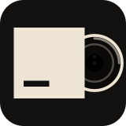

<h1 align="center">Albumscape Lock</h1>

<b>Your music, full screen on your Mac's lock screen.</b> 
Lock your Mac and whatever you're playing fills the screen: animated album art, the music video, synced lyrics and a small Liquid Glass player.

  <a href="https://github.com/aosmannn/albumscape-lock-releases/releases/latest/download/AlbumscapeLock-mac.dmg"><b>⬇ &nbsp;Download for Mac</b></a>
  &nbsp;·&nbsp;
  <a href="https://albumscape.vercel.app/mac">Website</a>

Free · macOS 14 or newer · no account · works with Spotify and Apple Music

---

## Get started in 3 steps

**1. Download it.** Click **Download for Mac** and open the disk image.

**2. Drag it to Applications.** Open Albumscape Lock. The first time, macOS says it can't check the app because it isn't notarized yet: open **System Settings → Privacy & Security**, scroll down and click **Open Anyway**.

**3. Follow the setup guide.** It opens by itself and asks for the few permissions it needs.

Then play a song and lock your Mac.

## What it does

- **Animated album art** (Apple Music's motion art) or the song's **music video**, full screen, with the time and **synced lyrics**.
- **Liquid Glass player.** Click the picture to shrink it to a small player; click again to enlarge it.
- **A visualizer** that moves with the real sound. It measures levels only; it never records audio or looks at your screen.
- **Nothing playing?** Your albums' moving covers shuffle, on the lock screen and behind your desktop icons.
- **Battery saver, multiple displays, update check.**
- Follows Spotify and Apple Music on your Mac (including music playing on your phone through Spotify's own device sync), and anything that scrobbles to Last.fm.

## Good to know

It draws over the lock screen with macOS calls Apple doesn't document, and reads Apple Music's public pages, so a macOS update or an Apple change can break it. It never touches your password. Not affiliated with Apple or Spotify.

Also on Windows: **[Albumscape](https://github.com/aosmannn/albumscape-releases)**.
